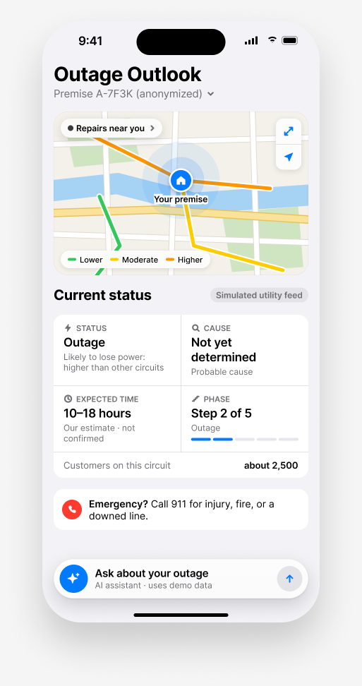
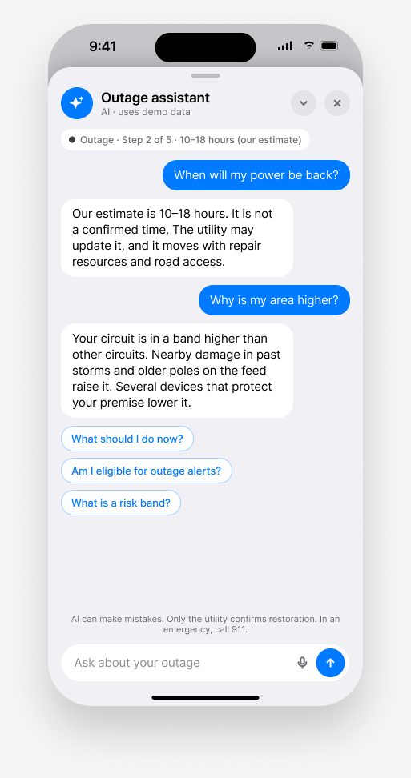
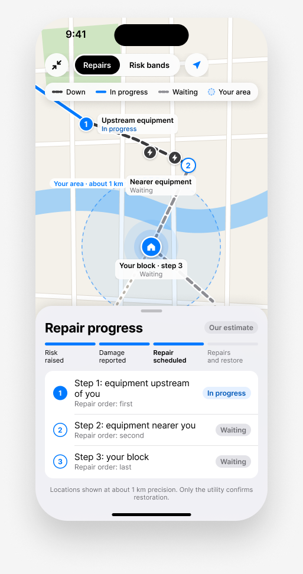

# Phone UI: final design

Reference for Lane C (`frontend/`). The design lives in Figma; this folder holds the spec and exported screens.

- Figma file: https://www.figma.com/design/kR319RccSN9CsJbU7mdjGw/Outage-Concierge (page **5 · Map + status + chat**)
- Clickable prototype: https://www.figma.com/proto/kR319RccSN9CsJbU7mdjGw/Outage-Concierge?node-id=26-35&page-id=26%3A34&starting-point-node-id=26%3A35&scaling=min-zoom&content-scaling=fixed

Pages 1-4 in the file are earlier explorations. Build from page 5 only.

## Screens

| | Screen | Maps to (MASTER_PLAN §7 Lane C) |
|---|---|---|
|  | **Status + chat (collapsed).** Map in a rounded box at the top. Under it, *Current status*: Status, Cause, Expected time, Phase (step x of 5 with a segment bar), customers on the circuit. Emergency line. Chat collapsed to a floating bar at the bottom. | Summary card (Mode 2), C7 emergency line |
|  | **Chat (expanded).** The bar grows into a full-screen sheet over the dimmed status screen. Pinned context chip (status · phase · range). Suggested questions. Minimize and close return to the bar. | Chat sheet (C6, N12) |
|  | **Map (expanded).** The map box grows to full screen. Layer switch *Repairs / Risk bands*. Lines down, work in progress, waiting for repair, "your area" ring (~1 km). Numbered repair order. *Repair progress* sheet: 4-step phase bar and the repair-order list. | Map sheet |

## Interactions

- Chat bar ⇄ expanded chat, map box ⇄ full map: Smart Animate, *Gentle* spring, 450 ms. The layers share names (`Chat`, `Map box`) so they morph instead of cutting.
- Web build: animate `transform` and `opacity` only. Under `prefers-reduced-motion`, cross-fade instead of grow.
- The emergency line stays visible on the status screen in every state (C7).

## Visual tokens

- Font: Inter (stand-in for SF Pro). Sizes 28 / 22 / 17 / 15 / 13 / 12 / 11. Slight negative tracking at 15 and above.
- Colors: iOS system palette. Blue `#007AFF` for actions and progress. Grouped background `#F2F2F7`, cards `#FFFFFF`, secondary text `#6E6E73`, separators `#C6C6C8`.
- Radii: phone sheet 28-36, cards 14, buttons 12, chips fully round.
- Map: land `#F4F1EA`, parks `#CFE5C2`, water `#A6D2F4`, white roads with a `#E0DBD2` casing.

## How the design follows the repo rules

1. **Red only for SAFETY** (Lane C §2). Red appears only on the emergency line. Bands: Low green `#34C759`, Moderate yellow `#FFCC00` (text `#8A6D00`), High orange `#FF9500` (text `#B25000`), always with a text label. The premise pin is blue; downed lines are dark gray `#3A3A3C`.
2. **No road names** (rule 5). The maps carry no street labels.
3. **No crew info** (rule 5). No crew markers or counts. A repair step shows "In progress", "Waiting" or nothing; the phase step reads "Repair scheduled".
4. **No device or circuit ids** (rule 5). Repair stops are generic: "Upstream equipment", "Nearer equipment", "Your block".
5. **Source chips** (rule 6, N3). Restoration numbers carry `Our estimate` (`model_estimate`). The current-status block carries `Simulated utility feed` (`simulated_feed`). `Utility confirmed` stays unused in the demo.
6. **Locations.** Damage and line positions on the expanded map are illustrative. Draw them from `/api` map cells (~1 km), never from exact coordinates.

## Not designed yet

Low-power mode (N5), the Prepare / Alerts / "How sure are we?" sheets, the demo panel, and the "Risk bands" layer of the expanded map.
