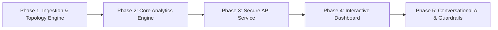

# Roadmap: AI Outage Concierge

## Overview

A 5-phase progressive build taking the AI Outage Concierge from raw GIS shapefiles, topology chains, and labor workbooks into an operational, highly responsive, explainable, and privacy-preserving customer web concierge.

## Phases

- [x] **Phase 1: Ingestion & Topology Engine** - Stream shapefiles, DBF tables, topology paths, and labor formulas into a high-performance SQLite database with salted premise hashing.
- [ ] **Phase 2: Core Analytics Engine** - Implement pure, deterministic functions for risk scoring, labor duration calculation, step restoration, preparation guidance, and alert rules.
- [ ] **Phase 3: Secure API Service** - Build the FastAPI backend with strict privacy allowlists, 1km facility rounding, scenario recomputation, and audit logging.
- [ ] **Phase 4: Interactive Customer Experience & Scenario Dashboard** - Deliver a clean, responsive single-page dashboard with interactive map, premise risk card, scenario sliders, and storm replay.
- [ ] **Phase 5: Conversational AI Concierge & Quality Verification** - Connect the 4-question chat assistant with strict anti-hallucination number verification, human escalation paths, and full demo script validation.

---

## Phase Details

### Phase 1: Ingestion & Topology Engine
**Goal**: Transform raw GIS archives (`Data1.zip`, `Data2.zip`, `matched_upstream.zip`, `Install_Labor_HackOHIO.xlsx`) into an optimized, indexed SQLite database (`outage_concierge.db`) with zero external DB dependencies and 100% data integrity.
**Depends on**: Nothing
**Requirements**: REQ-01, REQ-17, REQ-20, REQ-23
**Success Criteria**:
  1. Ingestion script runs in <60 seconds without out-of-memory errors.
  2. Row count sanity checks pass exactly: 1,659 damage records, 117,642 premises, 117,599 topology rows.
  3. Every premise is assigned a salted SHA-256 hash key; raw premise IDs and address fields are dropped.
  4. Topology rows map 100% of premise keys to ordered upstream isolating devices and circuit breakers.
  5. Labor reference tables contain exact install/removal hours, access adders, and the 4.5 Indirect Labor Multiplier.
**Plans**: 3 plans
- [x] 01-01: SQLite schema definition, lightweight DBF reader, and premise hashing utility.
- [x] 01-02: ARCOS damage ingestion, storm event tagging (Feb 2025 vs Sept 2024), and labor workbook extraction.
- [x] 01-03: Topology chain parser, critical facilities loader (with 1km coordinate rounding), and database verification suite.

### Phase 2: Core Analytics Engine
**Goal**: Build pure, testable mathematical engines for risk scoring, restoration modeling, step restoration sequencing, preparation checklists, and alert qualification.
**Depends on**: Phase 1
**Requirements**: REQ-02, REQ-03, REQ-04, REQ-05, REQ-06, REQ-07, REQ-09, REQ-11, REQ-12, REQ-13, REQ-14, REQ-15, REQ-16, REQ-18
**Success Criteria**:
  1. Risk engine calculates percentile-normalized score across circuits, categorizing into Low/Moderate/High bands with confidence rating.
  2. Restoration engine applies formula: `Sum(Damage × Labor Hours) × 4.5 (ILM) ÷ Crews + Access Penalties`, returning asymmetric P10 (-25%) to P90 (+40%) range.
  3. Step-restoration engine orders repair priorities by upstream isolating equipment, reporting percentage of premises restored at each step without leaking internal device IDs.
  4. Preparation engine dynamically generates checklists segmented into Safety vs Action items, conditioned on risk band, duration bucket (<4h, 4-24h, >24h), and declared medical needs.
  5. Alert rules engine evaluates qualification criteria and outputs the exact triggering rule plus timing and channel recommendation.
  6. Unit test suite passes 100% with zero mock failures.
**Plans**: 3 plans
- [ ] 02-01: Risk scoring model, factor attribution, and confidence/fallback evaluator (`core/risk.py`).
- [ ] 02-02: Restoration duration model, crew/access sensitivity, and step-restoration sequencer (`core/restoration.py`).
- [ ] 02-03: Preparation checklist generator, alert eligibility rules, and message template formatter (`core/guidance.py`, `core/alerts.py`).

### Phase 3: Secure API Service
**Goal**: Expose core analytical capabilities over a high-speed FastAPI web service with strict privacy filtering, sensitivity parameters, and audit logging.
**Depends on**: Phase 2
**Requirements**: REQ-01, REQ-06, REQ-08, REQ-16, REQ-17, REQ-19, REQ-20, REQ-21, REQ-22
**Success Criteria**:
  1. All 7 core endpoints respond in <100ms: `/api/premise/{key}/risk`, `/api/premise/{key}/restoration`, `/api/premise/{key}/prepare`, `/api/premise/{key}/alerts`, `/api/circuits`, `/api/storms`, `/api/operator/queue`.
  2. Privacy filter drops 100% of non-allowlisted fields; zero customer names, street addresses, or employee names exist in API responses.
  3. Scenario endpoints dynamically accept severity, crew count, access difficulty, and network lockout toggles, returning updated figures.
  4. Audit logging middleware logs query metadata, intent, and timestamp without PII.
  5. Automated API security test verifies privacy allowlist across all endpoints.
**Plans**: 2 plans
- [ ] 03-01: FastAPI application setup, Pydantic schemas, allowlist privacy middleware, and circuit/storm metadata endpoints.
- [ ] 03-02: Premise risk, restoration, guidance, scenario recomputation, and operator queue endpoints with automated test suite.

### Phase 4: Interactive Customer Experience & Scenario Dashboard
**Goal**: Build an elegant, accessible, responsive single-page web dashboard enabling customers and hackathon judges to explore risk, test scenarios, and visualize network impact.
**Depends on**: Phase 3
**Requirements**: REQ-01, REQ-02, REQ-03, REQ-04, REQ-05, REQ-06, REQ-07, REQ-08, REQ-09, REQ-10, REQ-11, REQ-12, REQ-13, REQ-15, REQ-16, REQ-18, REQ-19, REQ-20, REQ-21
**Success Criteria**:
  1. Map displays circuits colored by risk band, with click-to-select snapping to the nearest premise.
  2. Premise card displays risk badge, confidence meter, top contributing factors, P10-P90 restoration bar, and step restoration timeline.
  3. Interactive scenario panel features working sliders for storm severity, crew count, access constraints, and storm replay selector.
  4. Preparation tab features persistent safety callout, emergency 911 banner, and user-declared medical/special needs checkboxes.
  5. Operator view toggles damage heatmap and priority facility proximity queue.
  6. Passes accessibility checks (keyboard navigation, high-contrast labels, zoomable up to 200%).
**Plans**: 2 plans
- [ ] 04-01: HTML5/CSS/Vanilla JS frontend architecture with Leaflet circuit/premise map and dark/light accessible theme.
- [ ] 04-02: Reactive premise card, scenario slider integration, step restoration visualizer, and checklist interaction.

### Phase 5: Conversational AI Concierge & Quality Verification
**Goal**: Implement the AI Chat Concierge answering the four core challenge questions with strict anti-hallucination guardrails, human escalation paths, and comprehensive demo script validation.
**Depends on**: Phase 4
**Requirements**: REQ-14, REQ-21, REQ-22, REQ-24
**Success Criteria**:
  1. Conversational interface correctly routes the 4 challenge questions to backend tool calls.
  2. Anti-hallucination number validator intercepts LLM output and rejects any response containing numbers not present in the tool JSON payload.
  3. Fallback and human escalation options ("Connect to Utility Specialist") display prominently for low-confidence or high-risk queries.
  4. Complete 8-step demo script (Section D of `CHECKLIST.md`) executes end-to-end without errors.
**Plans**: 2 plans
- [ ] 05-01: Chat assistant endpoint, tool-calling integration, and regex anti-hallucination number-check validator.
- [ ] 05-02: Human escalation flow, audit trail logging, and end-to-end demo verification script.
